<div align="center">

# Student_Bayes

**Bayesian modeling of student habits and performance, with reproducible evaluation and a visual evidence portfolio.**

[](https://github.com/rohaan2802/Student_Bayes)
[](https://www.pymc.io/projects/docs/en/stable/learn/core_notebooks/GLM.html)
[](data/Syn_student.csv)
[](src/analyze.py)
[](reports/group_summary.csv)
[](reports/baseline_metrics.json)
[](notebooks/student_models.ipynb)

</div>

---

## Live Links

| What | Link |
|---|---|
| Repository | [https://github.com/rohaan2802/Student_Bayes](https://github.com/rohaan2802/Student_Bayes) |
| GitHub Pages | [https://rohaan2802.github.io/Student_Bayes/](https://rohaan2802.github.io/Student_Bayes/) |
| Project resource | [https://www.pymc.io/projects/docs/en/stable/learn/core_notebooks/GLM.html](https://www.pymc.io/projects/docs/en/stable/learn/core_notebooks/GLM.html) |

---

## Contents

1. [Live Links](#live-links)
2. [Overview](#overview)
3. [What’s Inside](#inside)
4. [Dataset and Inputs](#data)
5. [Methods and Model Breakdown](#methods)
6. [Evaluation Pipeline](#pipeline)
7. [Results and Interpretation](#results)
8. [Probability Explorer](#explorer)
9. [Source and Project Files](#source)
10. [Setup and Run](#setup)
11. [Saved Outputs and Demo](#outputs)
12. [Verification](#verification)
13. [Limitations and Responsible Use](#limitations)
14. [Figures](#figures)
15. [About the Author](#author)

---

<a id="overview"></a>
## Overview

Student_Bayes investigates how recorded study habits relate to quiz performance and student categories. It combines an executed Bayesian study with an independently runnable evaluation pipeline, a portable probability model, and a searchable gallery of real outputs.

The central finding is a strong association between study hours and quiz score, alongside substantial overlap between predictors. Model uncertainty, leakage prevention, and the limits of a small synthetic dataset are part of the analysis rather than footnotes.

- 150 supplied synthetic observations; five recorded fields; three balanced categories.
- Eight Bayesian models covering correlation, four regression variants, two group-mean models, and multiclass classification.
- A reproducible Python application, IDE workspace, exported reports, and a browser-based probability explorer.

<a id="inside"></a>
## What’s Inside

| Artifact | Location | Purpose |
| --- | --- | --- |
| Bayesian study | notebooks/student_models.ipynb | Maintained notebook with model definitions, diagnostics, intervals and saved outputs |
| Enhanced application | src/analyze.py | Validation, train-only evaluation, CLI prediction and portable model export |
| Project configuration | pyproject.toml | Dependencies, optional extras and student-bayes command |
| IDE project | Student_Bayes.code-workspace | Open the project; run analysis, build, preview and tests |
| Portfolio build | src/build_portfolio.py + src/portfolio_content.py | Generate the same 24 figures and shared documentation |
| Evidence exports | reports/ | Metrics, row-level probabilities, regression comparison and importance |
| Original assignment | archive/assignment_template.ipynb | Preserved instructions and task context |

<a id="data"></a>
## Dataset and Inputs

The original CSV is retained without modifying its values. A zero-based source_row in the prediction export identifies the corresponding data row, excluding the header. The target student_type is never included among predictive features.

| Field | Role | Interpretation |
| --- | --- | --- |
| study_hours | Predictor / grouped outcome | Recorded study hours |
| sleep_hours | Predictor | Recorded sleep hours |
| social_time | Predictor | Recorded social time |
| quiz_score | Regression target | Continuous recorded quiz score |
| student_type | Classification target / group | Original labels: bad, good, excellent |

Validation checks exact schema, complete rows, finite numeric values, nonnegative hours, varying predictors, and sufficient cases per class. Missing values and duplicates are counted explicitly. Each supplied category contains 50 rows. No generation procedure, time window for hours, or formal score bounds was supplied.

<a id="methods"></a>
## Methods and Model Breakdown

| Model | Specification | Question |
| --- | --- | --- |
| Bayesian correlation | Bivariate Normal with Uniform(-1,1) rho | How uncertain is the study-score correlation? |
| Simple Gaussian | Centered study hours; Normal mean and slope priors | How does the expected score vary with study hours? |
| Robust Student-t | Same mean; nu = 2 + Exponential(1/10) | Does a heavier-tailed likelihood change the slope? |
| Quadratic | Centered hours and squared hours | Is there convincing evidence for curvature? |
| Multiple regression | All habits standardized with sample SD | What associations remain when other habits are held fixed? |
| Unpooled group means | Independent category mean priors | How do study hours differ across recorded categories? |
| Hierarchical group means | Shared center and between-group scale | How much information do categories share? |
| Bayesian Softmax | Reference score fixed to zero; Categorical likelihood | Which category has the largest posterior mean probability? |

The notebook uses 94% highest-density intervals and seed 42. Sampling uses four chains with 1,500 tuning and 1,000 retained draws per chain. Regression bands describe the fitted mean, not the wider distribution of a new student’s score. Bayesian R² in this study describes fit to the observed sample.

The enhanced application adds frequentist logistic regression, study-only OLS, multiple OLS, Ridge with fixed alpha=1, and mean/prior dummy baselines. These are transparent comparison models; they do not reproduce Bayesian posterior draws.

<a id="pipeline"></a>
## Evaluation Pipeline

- Validate the CSV and create a seed-42 stratified 120/30 train/test split.
- Fit StandardScaler and multinomial logistic regression inside a single training pipeline.
- Run 5-fold stratified CV repeated three times on the 120 training rows only. Each fold refits its own scaler.
- Calculate permutation importance on validation folds inside training data using the increase in log loss after shuffling each predictor.
- Score the reserved 30-row holdout once per fixed model: accuracy, log loss, multiclass Brier score and class-wise precision/recall.
- Fit regression comparisons on the same training rows and report holdout RMSE, MAE and R². Keep descriptive full-sample OLS separate.
- Export numeric coefficients, training mean/scale, source-row predictions and an environment/data fingerprint.

```python
pipeline = make_pipeline(
    StandardScaler(),
    LogisticRegression(max_iter=2000),
)
pipeline.fit(X_train, y_train)
probabilities = pipeline.predict_proba(X_test)
```

No hyperparameter search is performed on the holdout. Cross-validation folds overlap across repeats, so their standard deviation is descriptive variation, not a confidence interval. Permutation importance can be shared or diluted by correlated predictors.

<a id="results"></a>
## Results and Interpretation

| Measure | Value | Evidence / scope |
| --- | --- | --- |
| Logistic holdout accuracy | 100.0% (30/30) | Fresh baseline; 10 cases per category |
| 95% Wilson interval | 88.6% to 100.0% | Binomial interval conditional on the small test sample |
| Training-only repeated CV | 100.0%; SD 0.0% | 15 validation scores; reserved test rows excluded |
| Prior-only dummy accuracy | 33.3% | Same holdout; class-prior baseline |
| Holdout log loss | 0.0626 | Lower is better; evaluates probability quality |
| Multiclass Brier score | 0.0158 | Mean sum of squared class-probability errors; range 0–2 |
| Descriptive OLS R² | 0.911 | Full-sample fit, not held-out performance |
| Saved Bayesian rho | 0.937; 94% HDI 0.917–0.954 | Embedded notebook posterior |
| Saved multiple Bayesian R² | 0.909 | Embedded notebook; in-sample |
| Saved Bayesian classifier | 30/30 correct | Embedded notebook; separate model |

| Regression holdout model | RMSE | MAE | R² |
| --- | --- | --- | --- |
| Mean-only | 2.119 | 1.805 | -0.001 |
| Study-only OLS | 0.742 | 0.608 | 0.877 |
| Multiple OLS | 0.655 | 0.554 | 0.904 |
| Ridge (alpha=1) | 0.655 | 0.554 | 0.904 |

Study hours correlate with quiz score at r=0.939; study and social time correlate at r=-0.936. In the saved Bayesian study, the study slope changes from 0.954 points/hour in the simple model to 0.507 after adjustment. This change and the wider adjusted interval illustrate why marginal associations cannot be read as independent effects.

Perfect classification within this synthetic dataset is evidence of strong separation in these rows. It is not evidence of error-free prediction for real students. The Wilson interval and baseline comparisons provide context, while the saved posterior checks address different questions.

<a id="explorer"></a>
## Probability Explorer

Enter study, sleep and social hours to inspect the fixed training-partition logistic baseline. The website applies the exported training scaler, coefficients and numerically stable Softmax entirely in the browser. No entries are sent to a server or saved.

This explorer uses frequentist baseline probabilities, not Bayesian posterior predictions or a calibrated student assessment. Values outside observed training ranges are flagged as extrapolation. Use the sample presets for a compact demonstration.

```sh
python src/analyze.py --predict 5 7 3
```

<a id="source"></a>
## Source and Project Files

The enhanced application lives alongside the original Bayesian notebook. All source needed to reproduce the baseline, reports, gallery and webpage is kept in this repository. The workspace provides build and test tasks; pyproject.toml records dependency groups and the CLI entry point.

[Open IDE project](Student_Bayes.code-workspace) · [Application source](src/analyze.py) · [Bayesian notebook](notebooks/student_models.ipynb) · [Project configuration](pyproject.toml) · [Portfolio builder](src/build_portfolio.py) · [Shared content](src/portfolio_content.py)

```text
Student_Bayes/
├── pyproject.toml                  # project metadata and command
├── Student_Bayes.code-workspace    # IDE tasks
├── data/Syn_student.csv            # original 150-row dataset
├── notebooks/student_models.ipynb  # Bayesian study with saved outputs
├── src/
│   ├── analyze.py                  # enhanced runnable application
│   ├── build_portfolio.py          # evidence figure generation
│   └── portfolio_content.py        # shared README/site content
├── reports/                        # metrics, predictions, model and checks
├── assets/                         # themes, controls and 24 figure pairs
├── tests/                          # correctness and browser checks
├── docs/                           # methodology, data and verification
└── archive/                        # original assignment template
```

<a id="setup"></a>
## Setup and Run

Use Python 3.12 or newer for the baseline. Open Student_Bayes.code-workspace in VS Code, select the environment, then use the Run analysis task. The direct commands below also work from a terminal; no IDE is required.

```powershell
python -m venv .venv
.venv\Scripts\Activate.ps1
python -m pip install -r requirements.txt
python src/analyze.py
python src/analyze.py --predict 5 7 3
python -m unittest discover -s tests
```

For the optional named command, install this checkout in editable mode: python -m pip install -e . and run student-bayes. Editable mode keeps the command connected to the repository dataset and reports. For a regular package installation, supply --data and --output explicitly. On macOS/Linux, activate the environment with source .venv/bin/activate.

```powershell
python -m pip install -r requirements-bayesian.txt
python -m jupyterlab notebooks/student_models.ipynb
# Run all cells from the repository or notebook directory.
```

The saved notebook records Python 3.12, PyMC 5.28.5 and ArviZ 0.23.4. Use an isolated compatible PyMC 5 / ArviZ 0.x environment for resampling. Nutpie is optional. A Bayesian run is substantially slower than the baseline; saved outputs are included for inspection.

<a id="outputs"></a>
## Saved Outputs and Demo

| Output | Contents |
| --- | --- |
| reports/baseline_metrics.json | Holdout/CV metrics, confusion labels, regression comparisons and correlations |
| reports/baseline_predictions.csv | Source row, three probabilities, actual/predicted labels and confidence |
| reports/demo_model.json | Training-only numeric parameters used by the browser explorer |
| reports/feature_importance.csv | Train-fold permutation importance: mean and spread |
| reports/regression_comparison.csv | Held-out RMSE, MAE and R² for four models |
| reports/group_summary.csv | Group mean, sample SD and median for numeric fields |
| reports/baseline_environment.json | Python/package versions and SHA-256 dataset fingerprint |
| assets/gallery.json | One ordered source for the 24 figure paths and captions |

```sh
python src/analyze.py
python src/build_portfolio.py
python -m http.server 8000
# Open http://localhost:8000/
```

- Inspect the baseline and held-out regression tables, then download the row-level predictions.
- Try sample presets in the explorer; compare the class probabilities and extrapolation warning.
- Search the figure gallery for regression; open a figure and use arrow keys, Previous/Next, zoom or swipe.
- Open the notebook to inspect priors, trace plots, posterior intervals and written interpretation.

[Metrics JSON](reports/baseline_metrics.json) · [Prediction CSV](reports/baseline_predictions.csv) · [Regression CSV](reports/regression_comparison.csv) · [Importance CSV](reports/feature_importance.csv) · [Original data](data/Syn_student.csv)

<a id="verification"></a>
## Verification

Correctness checks cover repeatable predictions, split disjointness, rejection of malformed data, train-only preprocessing, exported-model probability parity and uncertainty intervals. Browser checks exercise both themes, responsive grids, mobile navigation, gallery search/filtering, viewer controls, explorer predictions and Back to Top.

Saved Bayesian outputs remain identified as saved evidence. A fresh full Bayesian run has not been verified in the current environment; baseline checks do not certify posterior sampling. The detailed verification report records tested scope and limitations.

```sh
python -m unittest discover -s tests
python -m pip install "playwright>=1.50,<2"
# Microsoft Edge must be installed; the check starts its own local server.
python tests/check_portfolio.py
```

[Verification report](docs/VERIFICATION.md) · [Methodology](docs/METHODOLOGY.md) · [Data dictionary](docs/DATA.md) · [Provenance](docs/PROVENANCE.md)

<a id="limitations"></a>
## Limitations and Responsible Use

- The data are synthetic and small. Strong class separation and balanced groups may not occur in real cohorts.
- There are only 30 held-out observations. Perfect accuracy and repeated training-fold scores do not prove external generalization or probability calibration.
- Correlated study and social hours make attribution unstable. Coefficients and permutation importance describe the fitted models, not causal effects.
- Regression priors, likelihoods and score bounds can affect conclusions. Gaussian models allow outcomes beyond observed limits.
- Only three groups inform the hierarchical model; partial pooling is slight with 50 records per group.
- Generation details and a redistribution license were not supplied for the course data/material. No license is asserted on their behalf.
- Do not use this academic demo to rank, label or make decisions about real students.

## Figures

[01](#figure-01) · [02](#figure-02) · [03](#figure-03) · [04](#figure-04) · [05](#figure-05) · [06](#figure-06) · [07](#figure-07) · [08](#figure-08) · [09](#figure-09) · [10](#figure-10) · [11](#figure-11) · [12](#figure-12) · [13](#figure-13) · [14](#figure-14) · [15](#figure-15) · [16](#figure-16) · [17](#figure-17) · [18](#figure-18) · [19](#figure-19) · [20](#figure-20) · [21](#figure-21) · [22](#figure-22) · [23](#figure-23) · [24](#figure-24)

<a id="figure-01"></a>
### 01. Habit and score distributions

<p align="left"><a href="assets/figures/01-habit-and-score-distributions-v5.png">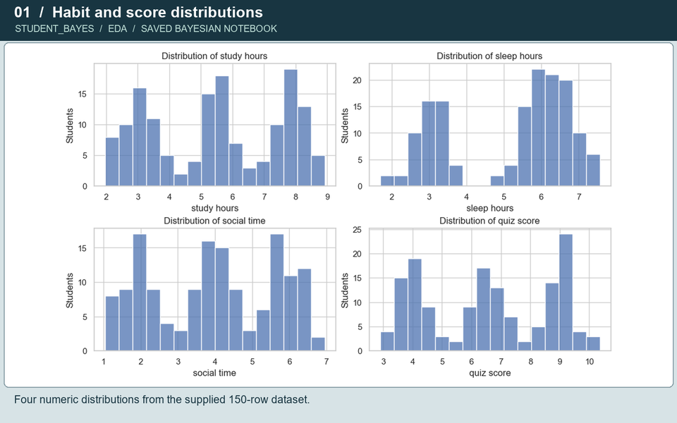</a></p>

Four numeric distributions from the supplied 150-row dataset.

<a id="figure-02"></a>
### 02. Habits against quiz score

<p align="left"><a href="assets/figures/02-habits-against-quiz-score-v5.png">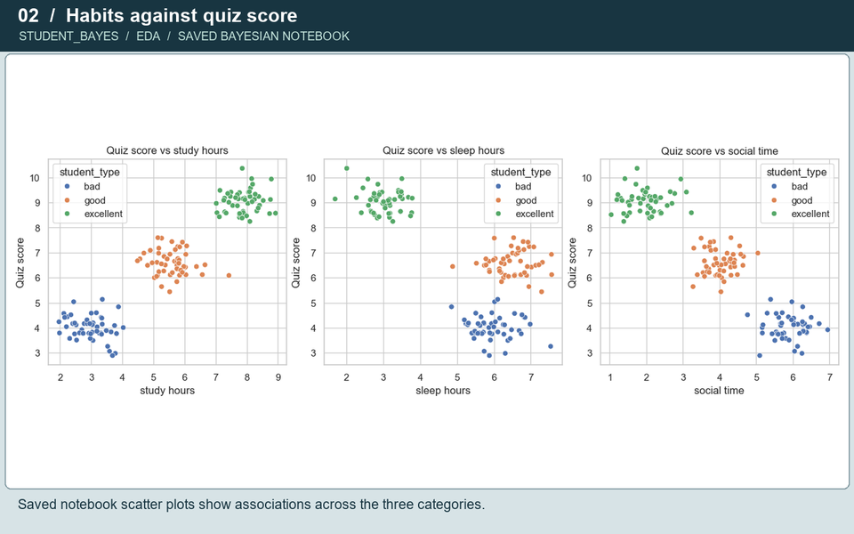</a></p>

Saved notebook scatter plots show associations across the three categories.

<a id="figure-03"></a>
### 03. Scores across student categories

<p align="left"><a href="assets/figures/03-scores-across-student-categories-v5.png">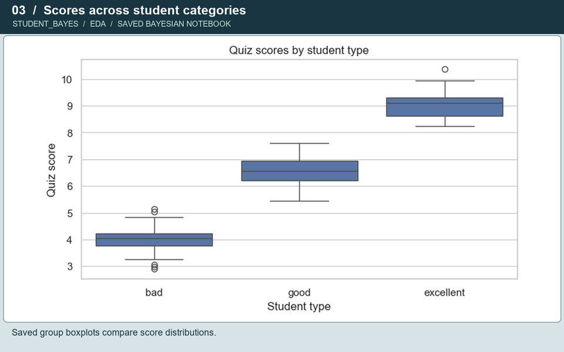</a></p>

Saved group boxplots compare score distributions.

<a id="figure-04"></a>
### 04. Pearson correlation matrix

<p align="left"><a href="assets/figures/04-pearson-correlation-matrix-v5.png">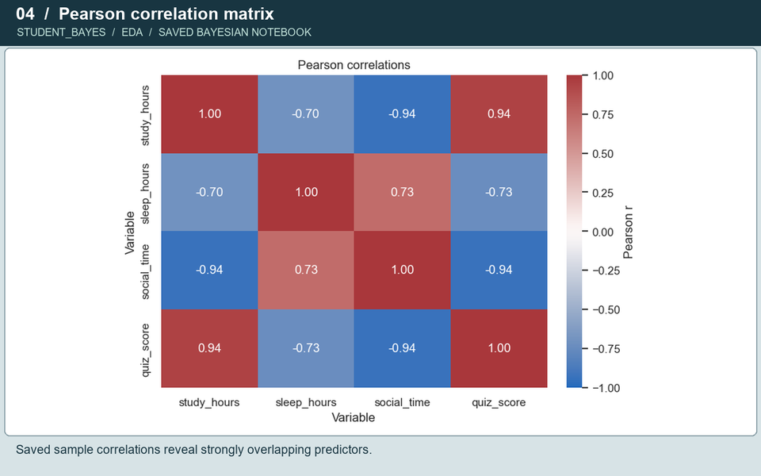</a></p>

Saved sample correlations reveal strongly overlapping predictors.

<a id="figure-05"></a>
### 05. Bayesian correlation posterior

<p align="left"><a href="assets/figures/05-bayesian-correlation-posterior-v5.png">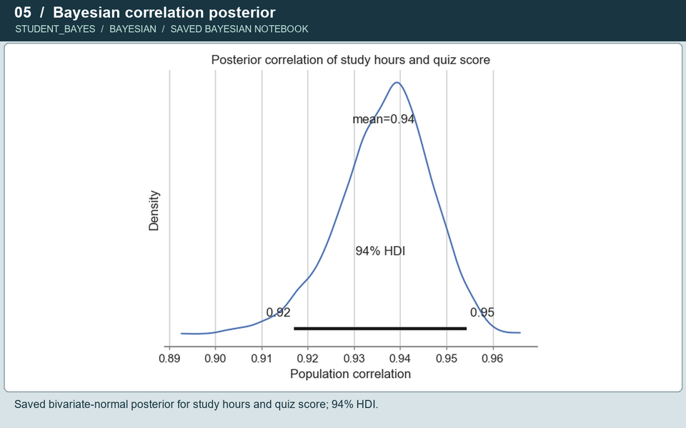</a></p>

Saved bivariate-normal posterior for study hours and quiz score; 94% HDI.

<a id="figure-06"></a>
### 06. Simple regression chain diagnostics

<p align="left"><a href="assets/figures/06-simple-regression-chain-diagnostics-v5.png">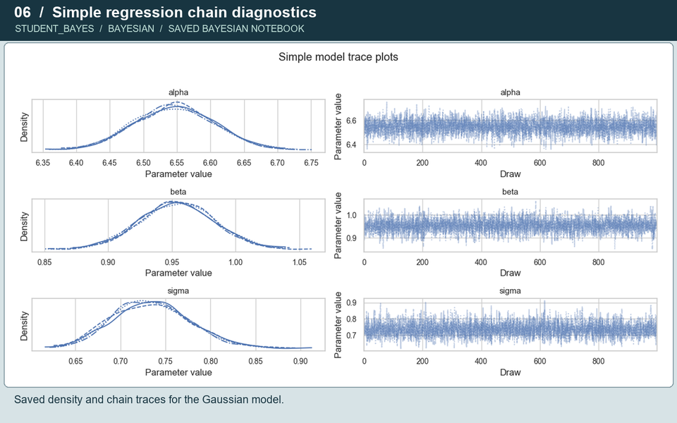</a></p>

Saved density and chain traces for the Gaussian model.

<a id="figure-07"></a>
### 07. Simple regression mean uncertainty

<p align="left"><a href="assets/figures/07-simple-regression-mean-uncertainty-v5.png">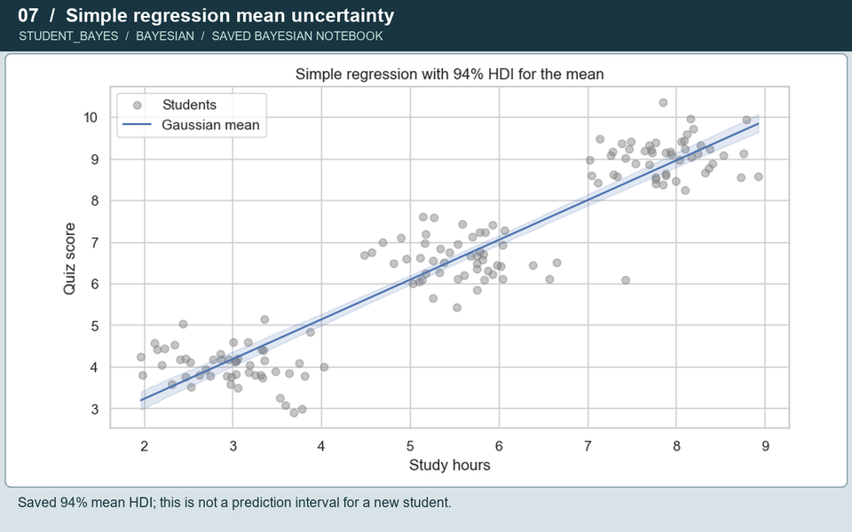</a></p>

Saved 94% mean HDI; this is not a prediction interval for a new student.

<a id="figure-08"></a>
### 08. Gaussian versus robust regression

<p align="left"><a href="assets/figures/08-gaussian-versus-robust-regression-v5.png">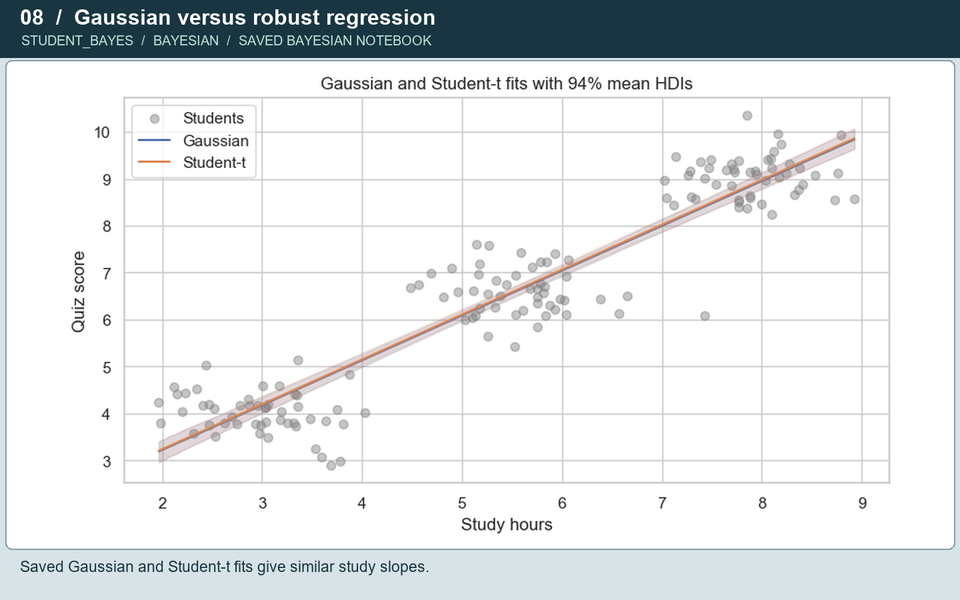</a></p>

Saved Gaussian and Student-t fits give similar study slopes.

<a id="figure-09"></a>
### 09. Linear versus quadratic regression

<p align="left"><a href="assets/figures/09-linear-versus-quadratic-regression-v5.png">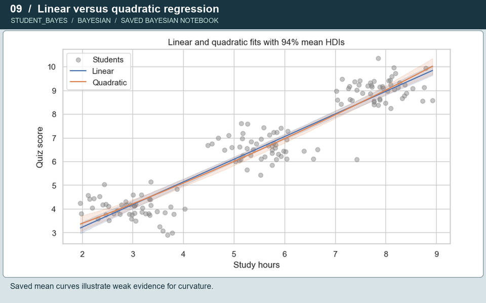</a></p>

Saved mean curves illustrate weak evidence for curvature.

<a id="figure-10"></a>
### 10. Multiple regression chain diagnostics

<p align="left"><a href="assets/figures/10-multiple-regression-chain-diagnostics-v5.png">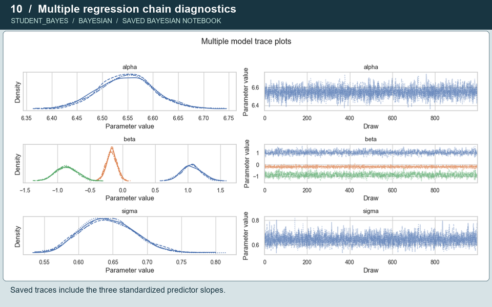</a></p>

Saved traces include the three standardized predictor slopes.

<a id="figure-11"></a>
### 11. Adjusted coefficient intervals

<p align="left"><a href="assets/figures/11-adjusted-coefficient-intervals-v5.png">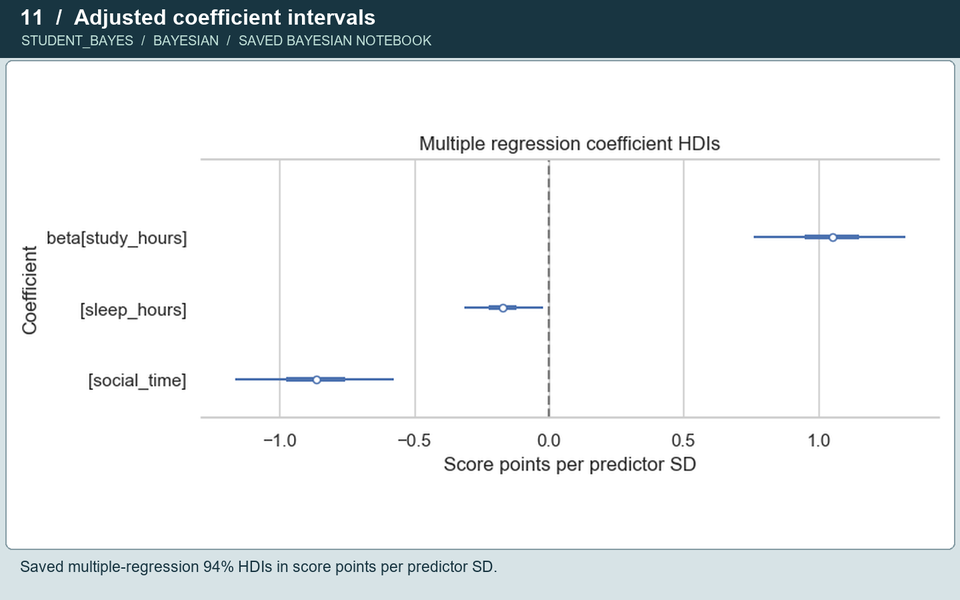</a></p>

Saved multiple-regression 94% HDIs in score points per predictor SD.

<a id="figure-12"></a>
### 12. Joint coefficient posterior

<p align="left"><a href="assets/figures/12-joint-coefficient-posterior-v5.png">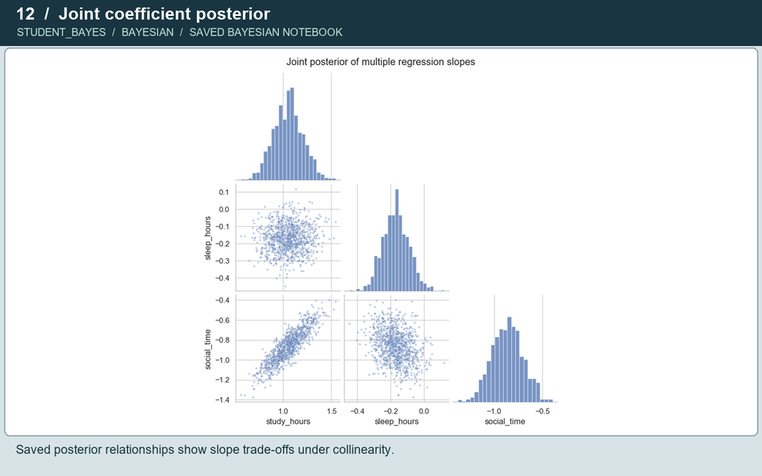</a></p>

Saved posterior relationships show slope trade-offs under collinearity.

<a id="figure-13"></a>
### 13. Posterior predictive checks

<p align="left"><a href="assets/figures/13-posterior-predictive-checks-v5.png">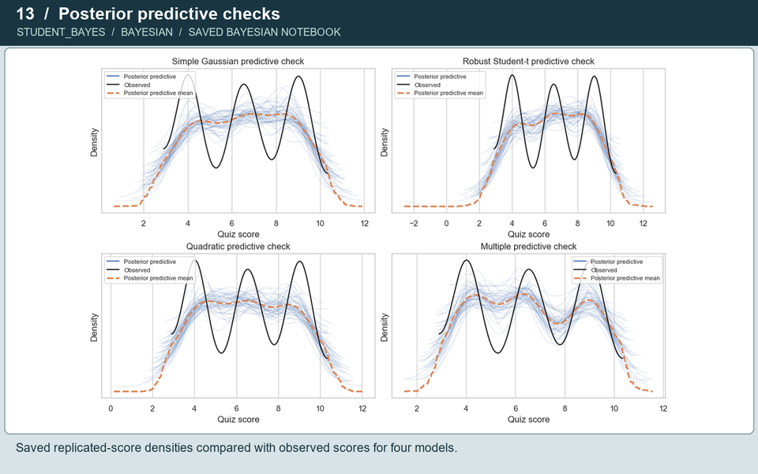</a></p>

Saved replicated-score densities compared with observed scores for four models.

<a id="figure-14"></a>
### 14. Unpooled and hierarchical means

<p align="left"><a href="assets/figures/14-unpooled-and-hierarchical-means-v5.png">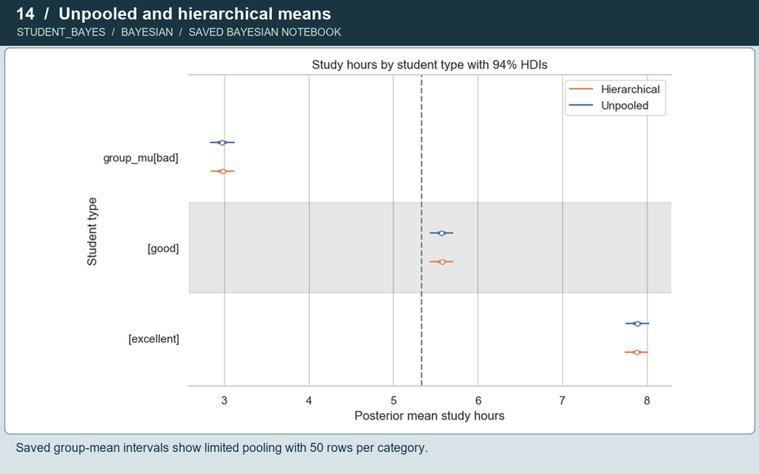</a></p>

Saved group-mean intervals show limited pooling with 50 rows per category.

<a id="figure-15"></a>
### 15. Bayesian test confusion matrix

<p align="left"><a href="assets/figures/15-bayesian-test-confusion-matrix-v5.png">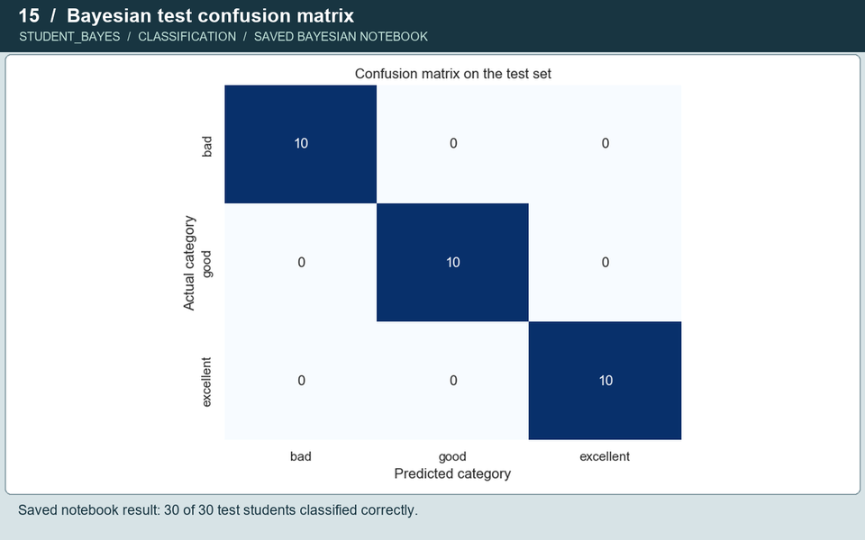</a></p>

Saved notebook result: 30 of 30 test students classified correctly.

<a id="figure-16"></a>
### 16. Balanced category counts

<p align="left"><a href="assets/figures/16-balanced-category-counts-v5.png">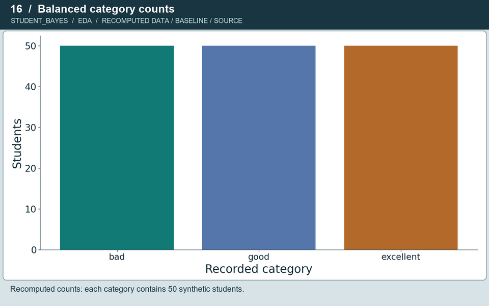</a></p>

Recomputed counts: each category contains 50 synthetic students.

<a id="figure-17"></a>
### 17. Training-only cross-validation

<p align="left"><a href="assets/figures/17-training-only-cross-validation-v5.png">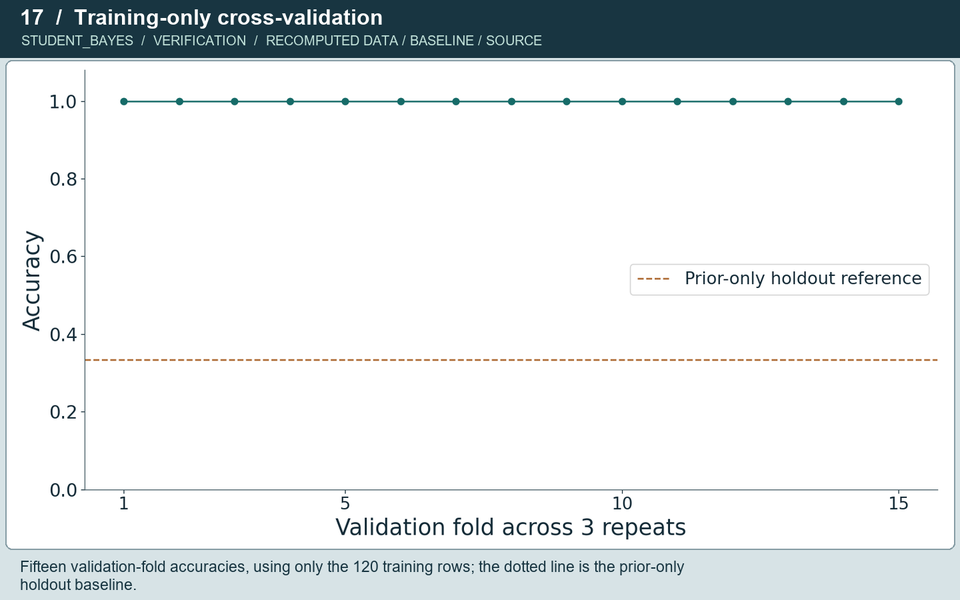</a></p>

Fifteen validation-fold accuracies, using only the 120 training rows; the dotted line is the prior-only holdout baseline.

<a id="figure-18"></a>
### 18. Study hours by category

<p align="left"><a href="assets/figures/18-study-hours-by-category-v5.png">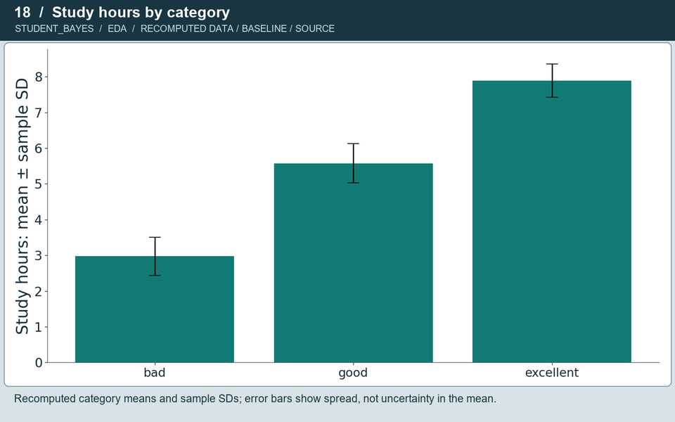</a></p>

Recomputed category means and sample SDs; error bars show spread, not uncertainty in the mean.

<a id="figure-19"></a>
### 19. Baseline test confusion matrix

<p align="left"><a href="assets/figures/19-baseline-test-confusion-matrix-v5.png">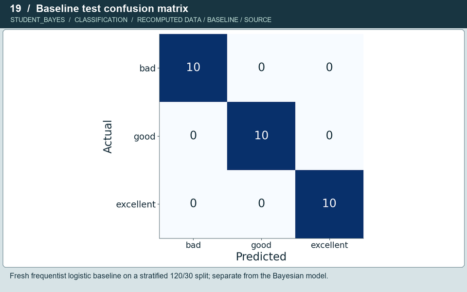</a></p>

Fresh frequentist logistic baseline on a stratified 120/30 split; separate from the Bayesian model.

<a id="figure-20"></a>
### 20. Baseline test class probabilities

<p align="left"><a href="assets/figures/20-baseline-test-class-probabilities-v5.png">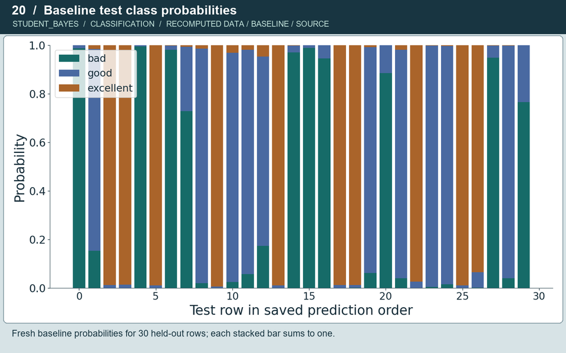</a></p>

Fresh baseline probabilities for 30 held-out rows; each stacked bar sums to one.

<a id="figure-21"></a>
### 21. Held-out regression comparison

<p align="left"><a href="assets/figures/21-held-out-regression-comparison-v5.png">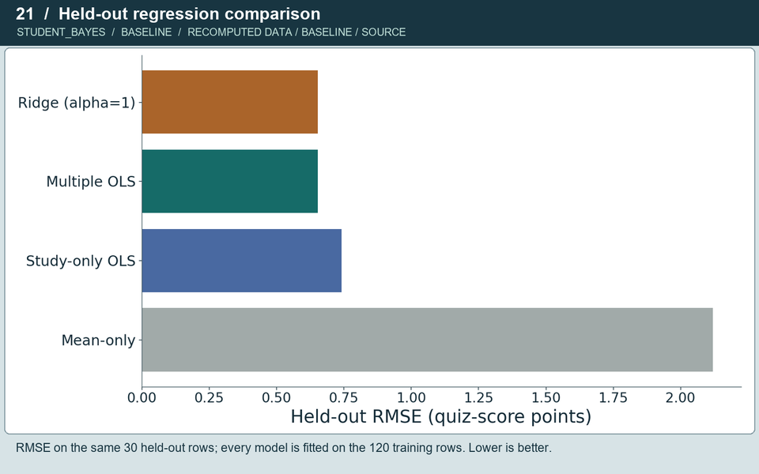</a></p>

RMSE on the same 30 held-out rows; every model is fitted on the 120 training rows. Lower is better.

<a id="figure-22"></a>
### 22. OLS residual pattern

<p align="left"><a href="assets/figures/22-ols-residual-pattern-v5.png">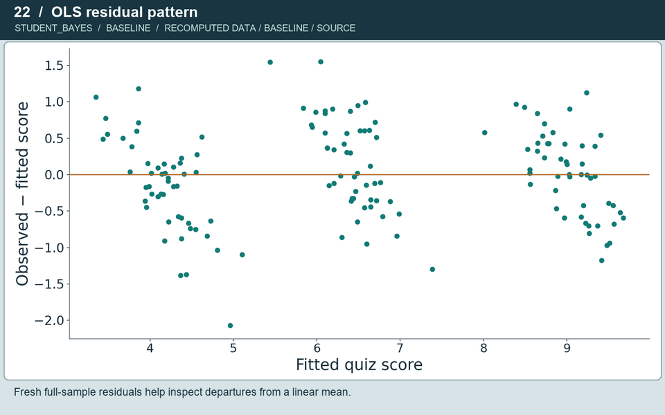</a></p>

Fresh full-sample residuals help inspect departures from a linear mean.

<a id="figure-23"></a>
### 23. Train-fold permutation importance

<p align="left"><a href="assets/figures/23-train-fold-permutation-importance-v5.png">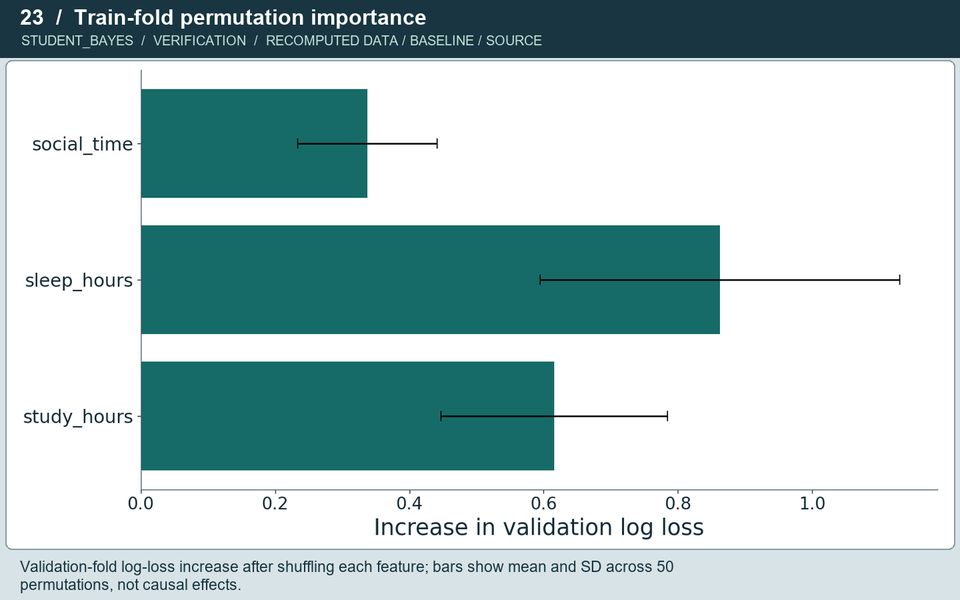</a></p>

Validation-fold log-loss increase after shuffling each feature; bars show mean and SD across 50 permutations, not causal effects.

<a id="figure-24"></a>
### 24. Training pipeline source

<p align="left"><a href="assets/figures/24-training-pipeline-source-v5.png">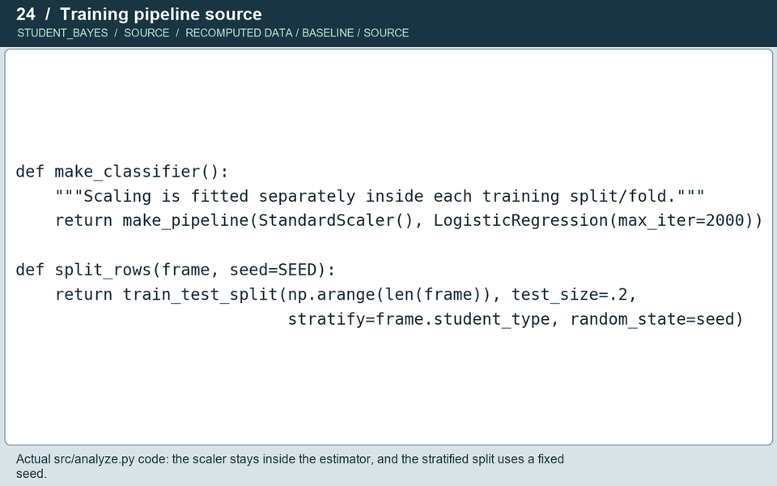</a></p>

Actual src/analyze.py code: the scaler stays inside the estimator, and the stratified split uses a fixed seed.

---

<a id="author"></a>
## About the Author

Mohammad Rohaan · FAST-NUCES · MT2002 Statistical Modeling · Fall 2026. This project demonstrates Bayesian reasoning, reproducible evaluation, clear evidence presentation and practical Python tooling.

The original notebook discloses OpenAI Codex assistance with drafting, execution and review. Results are tied to the supplied dataset and the methods shown in the source.

[GitHub profile](https://github.com/rohaan2802)

